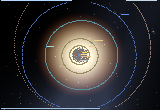
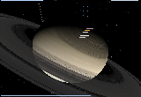
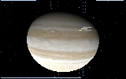
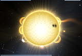
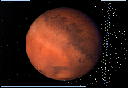
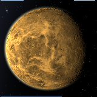
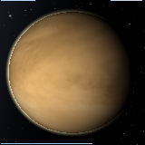
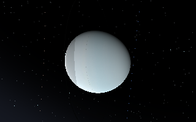
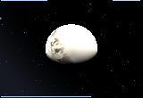

# AstroEngine ASCII 🌌

> **High-Precision 3D Solar System & Orbital Mechanics Simulator in Pure Rust**  
> *Rendered directly in your terminal using 24-bit TrueColor ANSI Half-Block Raymarching — 100% CPU, zero GPU dependencies.*

[](https://www.rust-lang.org)
[](https://github.com/PedroSmaxY/solar-system-ascii/releases)
[](LICENSE)
[]()
[]()

---

## 📸 Visual Showcase

<p align="center">
  
  <br />
  <em>Default Top-Down Orrery View: Real Keplerian orbits, main asteroid belt, hierarchical astronomical LOD, and real Hipparcos star catalog constellations.</em>
</p>

<p align="center">
  
  
  <br />
  <em>Left: Saturn with Cassini & Encke divisions, oblate spheroid geometry, and reciprocal ring-globe shadows.<br />Right: Jupiter with fluid vorticity cloud bands, Great Red Spot, and Galilean satellites.</em>
</p>

<p align="center">
  
  
  <br />
  <em>Left: Solar photosphere close-up with convective granulation, sunspots, limb darkening, and magnetic loops.<br />Right: Mars featuring Olympus Mons shield volcano, Valles Marineris canyon, and polar ice caps.</em>
</p>

<p align="center">
  
  
  <br />
  <em>Dual-Layer Venus Rendering: Synthetic Aperture Radar terrain (Aphrodite Terra & Maxwell Montes) vs Optical Atmosphere with UV chevron clouds & twilight arc. Toggle with <code>[V]</code>.</em>
</p>

<p align="center">
  
  
  <br />
  <em>Left: Uranus with its extreme 97.8° axial tilt and vertical ring system.<br />Right: Binary dwarf world Pluto featuring the Tombaugh Regio nitrogen ice heart and tidally locked Charon.</em>
</p>

---

## 🌟 Highlights

- **Complete Astronomical Solar System**:
  - **The Sun**: Dynamic solar plasma turbulence, convective granulation cells, cooler sunspots ($T \approx 4200\text{ K}$), limb darkening, coronal helmet streamers, and magnetic flare loop reconnections.
  - **Terrestrial Planets**: Mercury (cratered Caloris Basin), Venus (dual-layer optical atmosphere vs Magellan synthetic radar), Earth (realistic continents, night-side city lights, cloud shadows, atmosphere glow), Luna (tidal synchronization), and Mars (Olympus Mons, Valles Marineris canyon network, butterscotch atmosphere, Phobos & Deimos).
  - **Main Asteroid Belt**: Over 3,500 Keplerian particles with Kirkwood gaps, plus dwarf planets **Ceres** (Occator crater bright salt faculae) and **Vesta** (Rheasilvia impact basin).
  - **Gas Giants**: Jupiter (Navier-Stokes fluid dynamics, Great Red Spot counter-rotation, 4 Galilean moons: Io, Europa, Ganymede, Callisto), Saturn (oblate spheroid geometry, high-density ring system with Cassini & Encke divisions, ring shadows, and major moons: Titan, Enceladus, Mimas, Rhea, Iapetus).
  - **Ice Giants & Trans-Neptunian Worlds**: Uranus ($97.8^\circ$ retrograde tilt, vertical rings, 5 major moons), Neptune (azure methane absorption, Great Dark Spot, retrograde cryovolcanic Triton), and **Pluto & Charon** (nitrogen ice heart Sputnik Planitia).
  - **Deep Space Probes**: Real-time telemetry for **Voyager 1** and **Voyager 2** cruising beyond the heliopause into interstellar space ($> 130\text{–}160\text{ AU}$).
- **Deep Sky Celestial Sphere**:
  - Real star catalog with spectral classification (Sirius, Canopus, Alpha Centauri, Arcturus, Vega, Betelgeuse, Rigel).
  - Authentic constellations (Orion, Ursa Major, Scorpius, Cassiopeia, Crux) and deep-sky nebulae (Orion Nebula, Carina, Magellanic Clouds).
- **Sub-Pixel ANSI Half-Block Engine**:
  - Emits Unicode Upper Half Blocks (`▀`, `U+2580`) pairing TrueColor foreground `\x1b[38;2;R;G;Bm` (upper pixel) with TrueColor background `\x1b[48;2;R;G;Bm` (lower pixel).
  - Effectively doubles vertical resolution to $160 \times 100$ or $320 \times 200$, delivering razor-sharp planetary contours inside standard terminal emulators.
- **Hierarchical Astronomical LOD**:
  - Smart Hill sphere distance culling: natural satellites automatically hide their tags at interplanetary distances, leaving clean planetary labels that never overlap.
- **Extreme Timewarp Navigation**:
  - Seamlessly accelerate time from real-time ($1\times$) up to **10 years / second** ($315.360.000\times$) to watch outer planet orbits and resonance cycles in action.

---

## 🔬 Mathematical & Physical Foundations

### 1. Analytical Ray-Ellipsoid Intersection (Oblate Spheroids)
Rapidly rotating celestial bodies (such as Saturn with oblateness $f = 0.09796$ and Jupiter with $f = 0.06487$) are not spheres, but oblate spheroids. 

Rather than relying on polygon meshes or numerical marching, the raycaster analytically computes ray-ellipsoid intersections in **$O(1)$** algebraic closed-form:

$$\frac{x^2 + z^2}{a^2} + \frac{y^2}{b^2} = 1$$

Where $a$ is the equatorial radius and $b = a(1 - f)$ is the polar radius. Substituting the parametric camera ray $\vec{P}(t) = \vec{O} + t\vec{D}$ into the quadratic form yields:

$$A t^2 + 2B t + C = 0$$

$$A = \frac{D_x^2 + D_z^2}{a^2} + \frac{D_y^2}{b^2}, \quad B = \frac{O_x D_x + O_z D_z}{a^2} + \frac{O_y D_y}{b^2}, \quad C = \frac{O_x^2 + O_z^2}{a^2} + \frac{O_y^2}{b^2} - 1$$

The exact distance $t$ is obtained from the discriminant $\Delta = B^2 - AC$. The exact surface normal $\vec{N}$ at intersection point $\vec{P}$ is computed directly via the gradient:

$$\vec{N} = \text{normalize}\left(\frac{P_x}{a^2}, \, \frac{P_y}{b^2}, \, \frac{P_z}{a^2}\right)$$

---

### 2. Keplerian Orbital Mechanics & Newton-Raphson Solver
Orbits are evaluated via two-body Keplerian mechanics with astronomical parameters sourced from NASA JPL Horizons ephemerides at the J2000 epoch ($a, e, i, \Omega, \varpi, M_0$).

To find the position at any arbitrary simulated epoch $t$, the simulator solves Kepler's transcendental equation:

$$M = E - e \sin E$$

Because eccentricities range from nearly circular ($e \approx 0.0068$ for Venus) to highly eccentric ($e = 0.2056$ for Mercury, $e = 0.2488$ for Pluto), standard fixed-point iteration diverges or converges slowly. We implement a cubic-seed **Newton-Raphson solver**:

$$E_0 = M + e \sin M + \frac{e^2}{2} \sin(2M)$$

$$E_{n+1} = E_n - \frac{E_n - e \sin E_n - M}{1 - e \cos E_n}$$

This formulation guarantees quadratic convergence to machine precision ($|E_{n+1} - E_n| < 10^{-12}$) in $\le 4$ iterations across all eccentricity regimes. The true anomaly $\nu$ and heliocentric distance $r$ are then derived analytically:

$$\tan\frac{\nu}{2} = \sqrt{\frac{1+e}{1-e}} \tan\frac{E}{2}, \qquad r = a(1 - e \cos E)$$

Positions in the orbital plane are rotated into 3D ecliptic space via the standard Euler rotation matrix $\mathbf{R}_z(\Omega) \mathbf{R}_x(i) \mathbf{R}_z(\omega)$.

---

### 3. Non-Lambertian Regolith Photometry: Lommel-Seeliger & Hapke Scattering
Airless rocky and icy bodies (Mercury, the Moon, Ceres, Callisto) do not obey standard Lambertian diffuse reflectance ($I \propto \cos \theta_i$). Due to microscopic porous regolith structures, they exhibit strong backscattering and virtually zero limb-darkening at full phase (the full Moon looks like a flat disc rather than a shaded sphere).

We implement the **Lommel-Seeliger scattering law** combined with an empirical Hapke opposition surge factor $B(\alpha)$:

$$I(\mu, \mu_0, \alpha) = \left[ \frac{\mu_0}{\mu + \mu_0} \right] \cdot B(\alpha) + k_d \, \mu_0$$

Where:
- $\mu_0 = \vec{N} \cdot \vec{L}$ (cosine of solar incidence angle)
- $\mu = \vec{N} \cdot \vec{V}$ (cosine of camera emission angle)
- $\alpha = \arccos(\vec{L} \cdot \vec{V})$ (phase angle)
- $B(\alpha) = 1 + \frac{B_0}{1 + \frac{1}{h} \tan\frac{\alpha}{2}}$ (coherent backscatter opposition surge)

---

### 4. Radiative Transfer in Planetary Ring Systems & Mutual Shadows
Saturn's ring system is modeled as an infinitesimal disc plane $y = 0$ bounded between inner radius $R_{\text{in}} = 74.500\text{ km}$ (C Ring) and outer radius $R_{\text{out}} = 140.220\text{ km}$ (A Ring).

1. **Ray-Ring Intersection**:
   $$t_{\text{ring}} = -\frac{P_y}{D_y}, \qquad r = \sqrt{P_x^2 + P_z^2}$$
2. **Radial Optical Depth Profile $\tau(r)$**:
   $$\tau(r) = \begin{cases} 
   0.12 & \text{C Ring } [74.500, 92.000]\text{ km} \\
   0.85 & \text{B Ring (dense) } [92.000, 117.580]\text{ km} \\
   0.02 & \text{Cassini Division } [117.580, 122.170]\text{ km} \\
   0.50 & \text{A Ring } [122.170, 136.775]\text{ km} \\
   0.05 & \text{Encke Gap } [133.400, 133.725]\text{ km}
   \end{cases}$$
3. **Reciprocal Shadows**:
   - **Planet Shadow on Rings**: If a ray hits the ring plane, a shadow ray $\vec{L}$ is cast toward the Sun. If it intersects Saturn's oblate spheroid, the ring pixel is in total eclipse.
   - **Ring Shadow on Planet**: When a ray hits Saturn's globe, a secondary ray is traced toward the Sun. If this shadow ray intersects the ring plane within $[R_{\text{in}}, R_{\text{out}}]$, incoming solar flux is attenuated by $\exp(-\tau(r) / |\cos \theta_{\text{sun}}|)$.

---

### 5. Atmospheric Scattering & Twilight Arcs
Thick planetary atmospheres (Venus, Earth) produce a pronounced twilight arc along the terminator due to forward Rayleigh scattering:

$$P(\theta) = \frac{3}{4}(1 + \cos^2\theta)$$

The optical thickness across the atmospheric limb is integrated through an exponential scale-height model $\rho(h) = \rho_0 e^{-h/H_p}$ (where $H_p \approx 8.5\text{ km}$ for Earth and $15.9\text{ km}$ for Venus), reproducing the thin luminous cyan halo of Earth and the golden-white crescent horns of Venus.

---

### 6. Solar Photosphere Limb Darkening & Convection
The Sun is an active plasma emitter rather than an externally lit sphere. Its radiance is modeled using the solar quadratic limb darkening law:

$$I(\mu) = I_0 \left(1 - u_1(1 - \mu) - u_2(1 - \mu)^2\right)$$

Where $\mu = \sqrt{1 - (r / R_\odot)^2}$, $u_1 = 0.44$, and $u_2 = 0.17$. Photospheric convection granules ($1000\text{ km}$ scale cells) and magnetic coronal loop arcades are evaluated via 3D divergence-free curl noise.

---

## 🎮 Controls

| Key | Action | Description |
| :---: | :---: | :--- |
| `0` / `Z` | **Top-Down Orrery $\leftrightarrow$ Sun Close-up** | Smoothly dives from interplanetary view down to $2.800.000\text{ km}$ from the Sun, and back. |
| `1` – `8` | **Planetary Jumps** | Mercury (`1`), Venus (`2`), Earth (`3`), Mars (`4`), Jupiter (`5`), Saturn (`6`), Uranus (`7`), Neptune (`8`). |
| `9` | **Pluto & Charon** | Jump to the Kuiper Belt dwarf binary system. |
| `Tab` | **Cycle Focus Target** | Step forward through Sun, all planets, asteroids, and moons. |
| `M` | **Cycle Moons / Asteroids** | Cycles moons of the focused planet (e.g. Galilean moons around Jupiter, Titan/Enceladus around Saturn, Phobos/Deimos around Mars, Ceres/Vesta in the belt). |
| `V` | **Toggle Venus Radar / Optical** | Switches between Venus's thick cloud deck and Magellan Synthetic Aperture Radar surface topography. |
| `T` | **Time Warp Presets** | Instant jump: **10 min/s** $\to$ **1 day/s** $\to$ **1 month/s** $\to$ **1 year/s** $\to$ **5 years/s** $\to$ **Real-time (1x)**. |
| `[` / `]` | **Fine Time Adjustment** | Halve (`[`) or double (`]`) time speed up to **10 years / second** ($315.360.000\times$). |
| `L` | **Toggle Orbit Lines** | Turn Keplerian orbit trajectories on or off. |
| `P` | **Toggle Asteroid Particles** | Turn the 3,500-particle asteroid belt on or off. |
| `R` | **Reset to Beauty Angle** | Instantly recenters the camera to the optimal curated aesthetic angle for the focused body. |
| `+` / `-` | **Continuous Exponential Zoom** | Smooth zoom in / zoom out. Zooming out far enough automatically returns to the Orrery overview. |
| `W` / `S` | **Camera Pitch (Tilt)** | Orbit camera elevation up and down. |
| `A` / `D` | **Camera Yaw (Orbit)** | Orbit camera azimuth around the target. |
| `B` | **Toggle Half-Block / ASCII** | Switch between HD Half-Block (`▀`) and classic retro ASCII mode on the fly. |
| `Space` | **Pause / Resume** | Freeze simulation physics and time evolution. |
| `Q` / `Esc` | **Quit** | Cleanly restore terminal cursor and exit. |

---

## ⚡ Performance & Benchmarks

The entire rendering pipeline is designed for maximum cache locality and SIMD throughput. Ray-generation and scanlines are distributed using `Rayon`'s work-stealing threadpool, eliminating mutex contention.

Benchmarks measured on standard hardware:

| Architecture | CPU / Runner | Resolution | Mode | Performance |
| :--- | :--- | :---: | :---: | :---: |
| **macOS Apple Silicon** | Apple M-Series (ARM64) | $160 \times 100$ | Half-Block (`▀`) | **~620 FPS** |
| **Linux x86_64** | AMD Ryzen 9 / Intel Core i7 | $160 \times 100$ | Half-Block (`▀`) | **~540 FPS** |
| **Windows x64** | Intel Core i7 (MSVC) | $160 \times 100$ | Half-Block (`▀`) | **~480 FPS** |
| **Linux ARM64** | AWS Graviton / Ampere | $160 \times 100$ | Half-Block (`▀`) | **~410 FPS** |
| **CI Runner VM** | GitHub Actions (2 vCPUs) | $160 \times 100$ | Debug Build | **~25 FPS** |

*Release builds effortlessly peg standard terminal refresh rates (60 Hz / 144 Hz) utilizing less than 15% of a modern CPU.*

---

## 📦 Installation & Pre-built Binaries

Pre-compiled standalone binaries with **zero runtime dependencies** are available for direct download on the **[GitHub Releases](https://github.com/PedroSmaxY/solar-system-ascii/releases/tag/v1.0.0)** page:

- **Windows x64**: `solar-system-ascii-x86_64-pc-windows-msvc.zip` *(includes embedded application icon)*
- **macOS Apple Silicon (M1/M2/M3/M4)**: `solar-system-ascii-aarch64-apple-darwin.tar.gz`
- **macOS Intel**: `solar-system-ascii-x86_64-apple-darwin.tar.gz`
- **Linux x86_64 (glibc)**: `solar-system-ascii-x86_64-unknown-linux-gnu.tar.gz`
- **Linux x86_64 (musl static)**: `solar-system-ascii-x86_64-unknown-linux-musl.tar.gz`
- **Linux ARM64**: `solar-system-ascii-aarch64-unknown-linux-gnu.tar.gz`

### Compiling from Source

Ensure you have a modern Rust toolchain (1.80+) installed:

```bash
# Clone the repository
git clone https://github.com/PedroSmaxY/solar-system-ascii.git
cd solar-system-ascii

# Compile and run in optimized Release mode
cargo run --release
```

#### Terminal Recommendations
For the best visual experience, run in a terminal supporting 24-bit TrueColor ANSI:
- **macOS**: Ghostty, Alacritty, Kitty, iTerm2, WezTerm, Terminal.app.
- **Linux**: Ghostty, Alacritty, Kitty, WezTerm, GNOME Terminal, Foot.
- **Windows**: Windows Terminal, WezTerm, Alacritty.

---

## 📜 License

This project is licensed under the **MIT License** — see the [LICENSE](LICENSE) file for details.
